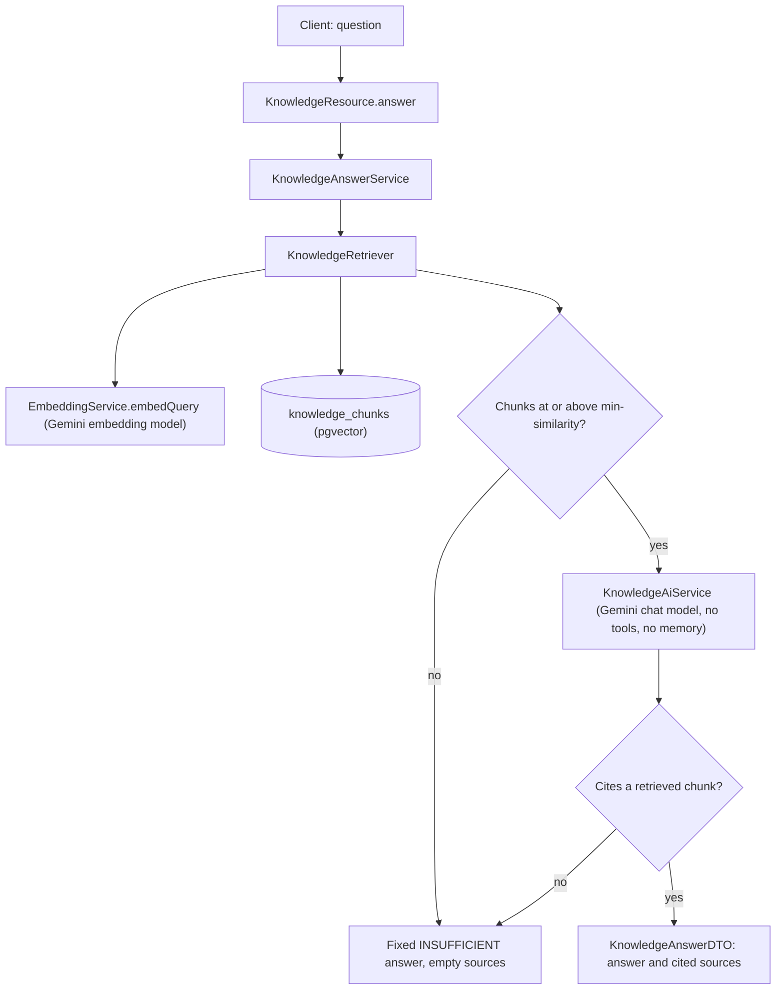
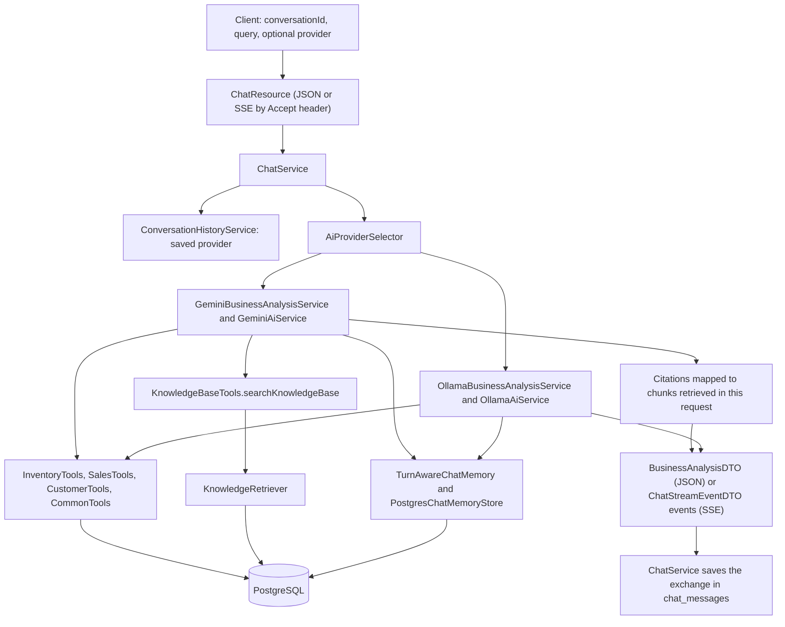

# AI Business Assistant — Backend

The Quarkus backend for AI Business Assistant. It answers business questions with Gemini or the company's Ollama server through two endpoints:

- `POST /api/chat` answers inventory, sales and customer questions from PostgreSQL data through read-only tools. With Gemini it also searches the company policies and combines both (hybrid analysis). It returns structured JSON or streams the answer, depending on the `Accept` header, and keeps a chat memory per conversation.
- `POST /api/knowledge/answer` answers a company-policy question only from the knowledge base (RAG), with the rules it cites.

The policies are Markdown files that the backend splits into chunks, embeds with a Gemini embedding model and stores in PostgreSQL with pgvector.

## Tech Stack

Versions defined in [pom.xml](pom.xml) and the Maven wrapper:

- Java 21 (`maven.compiler.release`)
- Quarkus 3.39.3 (`quarkus-bom` and `quarkus-langchain4j-bom`)
- Quarkus REST with Jackson
- Quarkus LangChain4j with the Gemini (`quarkus-langchain4j-ai-gemini`) and Ollama (`quarkus-langchain4j-ollama`) extensions; the BOM resolves Quarkus LangChain4j 1.13.1 and LangChain4j 1.19.0
- PostgreSQL JDBC driver, Hibernate ORM with Panache, Hibernate Vector (`hibernate-vector`) for the pgvector column, and Flyway (versions managed by the Quarkus BOM)
- Lombok 1.18.44
- Maven 3.9.11 via the wrapper ([maven-wrapper.properties](.mvn/wrapper/maven-wrapper.properties))
- PostgreSQL 18 with the pgvector extension (`pgvector/pgvector:0.8.7-pg18-trixie`)

## Architecture

Packages group code by business feature. `chat` holds the chat resource, the orchestration service, the AI service interfaces, history and memory; `knowledge` holds chunking, indexing, retrieval and the policy-answer endpoint; each business feature (`product`, `customer`, `order`) owns its entities, repositories and tools. The current-date tool and the tool error handler are shared under `common.tools`.

### Policy answers: `POST /api/knowledge/answer`



Retrieval runs in code, before the model is called. `KnowledgeEvidence` passes the retrieved chunks to the model as `<chunk>` blocks; each block's `id` is the chunk's rule ID, or `<file>#preamble` for a file's introduction. The server keeps only the cited IDs that belong to retrieved chunks and returns those chunks as `sources`. There is no chat memory and no conversation ID.

### Chat and hybrid analysis: `POST /api/chat`



The model decides which tools to call. `GeminiBusinessAnalysisService` reads the evidence of every `searchKnowledgeBase` call in the request and keeps only the citations that match those chunks, so `sources` never holds a rule the request did not retrieve.

### Providers

Each conversation is pinned to the provider of its first request (see [Switching the AI provider](#switching-the-ai-provider)). The tools are registered on the AI service interfaces:

| Feature | Gemini | Ollama |
| --- | --- | --- |
| Inventory, sales, customer and date tools | Yes (`GeminiAiService`) | Yes (`OllamaAiService`) |
| `searchKnowledgeBase` and policy `sources` in chat | Yes | No; `sources` is empty |
| `POST /api/knowledge/answer` | Yes (`KnowledgeAiService`) | No |
| Knowledge-base embeddings | Yes (always) | No |

`GeminiAiService` uses [prompts/business-analysis-gemini-system.txt](src/main/resources/prompts/business-analysis-gemini-system.txt), `OllamaAiService` uses [prompts/business-analysis-system.txt](src/main/resources/prompts/business-analysis-system.txt), and `KnowledgeAiService` uses [prompts/knowledge-answer-system.txt](src/main/resources/prompts/knowledge-answer-system.txt). Both chat models use temperature `0.1`.

### Tools

| Tool | Returns |
| --- | --- |
| `getLowStockProducts()` | Products at or below their minimum stock: ID, name, stock quantity, minimum stock. |
| `getProductStock(productId)` | The same fields for one product, or `No product found with id <id>.` when the product does not exist. |
| `getInventorySnapshot()` | The same fields for every product, ordered by ID, plus its `stockClass` (`OUT_OF_STOCK`, `CRITICAL`, `LOW`, `HEALTHY` or `OVERSTOCK`) computed by `StockClass` from the inventory policy thresholds INV-2 to INV-6. Which classes violate the policy and what to do come from the policy search. |
| `getSales(from, to)` | `from`, `to`, `totalSales` and `orderCount` for an inclusive date range. Both dates are required and `from` must not follow `to`. |
| `getCustomerStatistics(customerId)` | `customerId`, `customerName`, `orderCount`, `totalSpent` and `averageOrderValue` over all of the customer's orders, or `No customer found with id <id>.` when the customer does not exist. |
| `getCurrentDate()` | The backend's current `LocalDate`, used for relative dates. |
| `searchKnowledgeBase(query)` | Gemini only. The retrieved knowledge-base chunks as `<chunk>` blocks, or `No company policy matched this search.` |

The tools are read-only and are not exposed as REST endpoints. `averageOrderValue` is `totalSpent` divided by the order count, rounded to two decimals with `RoundingMode.HALF_UP`; a customer with no orders gets zero for all three values. When a tool throws, `RethrowingToolExecutionErrorHandler` fails the request instead of passing the error text to the model (see [Refusals and Errors](#refusals-and-errors)).

### Chat Memory

The chat memory keeps the system message and the latest 10 whole user turns (`app.chat.memory.max-turns=10`). The active window is stored in PostgreSQL (`chat_memory_state`), so it is restored after a backend restart. Successful user and assistant exchanges are stored separately in `chat_messages` and stay there when turns leave the active window.

### Business Prompt

The chat system prompts instruct the model to:

- Answer company-specific inventory, product, sales, order and customer questions, using the read-only tools when data is needed.
- Answer general concepts within those domains directly; company-specific data must come from the user or the tools.
- With Gemini, answer what the company policies say only from `searchKnowledgeBase` results and cite the rules used.
- Call the current-date tool for relative dates instead of guessing the date.
- For unrelated questions, return a brief out-of-scope `summary`, empty `insights`, and one business-focused suggestion in `recommendations`.
- Classify results, claim trends or causes, or assign customer segments only with supporting data or a supplied benchmark, and present optional explanations and suggestions as possibilities.
- Report facts first and state clearly when data or an entity is missing. Structured requests use the analysis DTO; streaming requests use plain text.

The prompts are packaged with the application, so a change needs a rebuild and restart (see [deploy/README.md](../deploy/README.md#rebuild-after-changes) for Compose).

### Logging

`ChatService` logs each AI request with the conversation ID, provider and duration, plus the query length and memory size for JSON requests. `KnowledgeAnswerService` logs the retrieved chunk IDs, valid and dropped citations, and whether the model was skipped. Each tool logs its call, its arguments or result counts, and failures. The query text is not logged.

## Project Structure

```text
Backend/
├── src/main/java/com/aibusinessassistant/
│   ├── chat/              # ChatResource (REST endpoint) and ChatService (AI calls, streaming, history)
│   │   ├── ai/            # BusinessAnalysisService contract, AiProvider, AiProviderSelector,
│   │   │                  # GeminiAiService / OllamaAiService and their adapters
│   │   ├── dto/           # ChatRequestDTO, BusinessAnalysisDTO, ChatStreamEventDTO, StreamEventType
│   │   ├── history/       # Conversation and ConversationMessage entities, repositories, ConversationHistoryService
│   │   └── memory/        # TurnAwareChatMemory, its provider, PostgresChatMemoryStore, ChatMemoryState
│   ├── knowledge/         # DocumentChunker, EmbeddingService, KnowledgeBaseIndexer, KnowledgeRetriever,
│   │                      # KnowledgeBaseTools, KnowledgeAnswerService, KnowledgeAiService, KnowledgeResource
│   ├── product/           # Product entity, ProductRepository, StockClass, DTOs, tools/InventoryTools
│   ├── customer/          # Customer entity, CustomerRepository, DTO, tools/CustomerTools
│   ├── order/             # Order and OrderItem entities, repositories, DTOs, tools/SalesTools
│   └── common/tools/      # CommonTools (current date), RethrowingToolExecutionErrorHandler
├── src/main/resources/
│   ├── application.properties
│   ├── prompts/           # business-analysis-gemini-system.txt, business-analysis-system.txt,
│   │                      # knowledge-answer-system.txt
│   ├── knowledge-base/    # customer-policy.md, inventory-policy.md, refund-policy.md
│   └── db/migration/      # Flyway migrations V1–V5
├── src/test/java/com/aibusinessassistant/
├── src/test/resources/eval/questions.json
├── Dockerfile
├── mvnw / mvnw.cmd
└── pom.xml
```

## Configuration

The backend reads these environment variables in [application.properties](src/main/resources/application.properties):

| Variable | Purpose | Default |
| --- | --- | --- |
| `GEMINI_API_KEY` | Gemini Developer API key, used for the Gemini chat and embedding models | None — required |
| `GEMINI_MODEL` | Gemini chat model ID | None — required |
| `AI_DEFAULT_PROVIDER` | Provider for new conversations that do not send `provider` (`GEMINI` or `OLLAMA`) | `GEMINI` |
| `OLLAMA_BASE_URL` | Ollama server origin, without `/api/chat` | `https://ai.llm.ensera.dev` |
| `OLLAMA_MODEL` | Ollama model ID | `qwen3-vl:8b-instruct-q8_0` |
| `OLLAMA_TIMEOUT` | Ollama request timeout | `PT2M` (Compose sets `120s`) |
| `DB_URL` | JDBC connection URL | `jdbc:postgresql://localhost:5432/ai_business_assistant` |
| `DB_USERNAME` | Database user | `ai_business_assistant` |
| `DB_PASSWORD` | Database password | None — required |
| `FRONTEND_ORIGIN` | Browser origin allowed by CORS (CORS allows `POST`) | `http://127.0.0.1:3000` |

`GeminiAiService` and `KnowledgeAiService` use the named model `business-gemini`, and `OllamaAiService` uses `business-ollama`. Ollama Dev Services are disabled because the backend uses an existing Ollama server. The `DB_*` variables apply only to dev and prod; tests use their own database (see [Tests](#tests)).

### Knowledge Base and Embeddings

These are fixed in `application.properties`, not environment variables:

| Property | Value | Meaning |
| --- | --- | --- |
| `quarkus.langchain4j.ai.gemini.business-gemini.embedding-model.model-id` | `gemini-embedding-001` | The one embedding model for both chunks (as documents) and questions (as queries). |
| `quarkus.langchain4j.ai.gemini.business-gemini.embedding-model.output-dimension` | `768` | Vector size. It must equal `EmbeddingService.DIMENSION` and the `VECTOR(768)` column from V5; changing it needs a new migration and re-embedding. |
| `app.knowledge-base.index-at-startup` | `true` (`false` in tests) | Index the knowledge-base files when the application starts. |
| `app.knowledge-base.retrieval.top-k` | `5` | Most chunks returned per search. |
| `app.knowledge-base.retrieval.min-similarity` | `0.66` | Lowest cosine similarity a chunk needs to count as evidence; calibrated for `gemini-embedding-001` at 768 dimensions. |

`EmbeddingService` checks the size of every vector and rejects one that is not 768 long.

### Environment File

The committed template is [deploy/.env.example](../deploy/.env.example); the local copy `deploy/.env` is ignored by Git. From the repository root, on first setup:

```bash
cp deploy/.env.example deploy/.env
```

Fill in `GEMINI_API_KEY` and a nonempty `POSTGRES_PASSWORD`, and check `GEMINI_MODEL`. Docker Compose maps `POSTGRES_USER`, `POSTGRES_PASSWORD` and `POSTGRES_DB` to `DB_USERNAME`, `DB_PASSWORD` and `DB_URL` for the backend container and has a password fallback; a backend run with Maven has no `DB_PASSWORD` default. See the [deployment guide](../deploy/README.md) for the Compose variables.

## Run Locally

Requires JDK 21 and Docker with the Compose plugin. From the repository root, start PostgreSQL with pgvector:

```bash
docker compose --env-file deploy/.env -f deploy/docker-compose.yml up -d --wait postgres
```

Then, still from the repository root, load `deploy/.env`, map its PostgreSQL settings to the backend variables, and start dev mode. Keep the file's values shell-compatible, quoting spaces and special characters:

```bash
set -a
. ./deploy/.env
set +a
export DB_URL="jdbc:postgresql://localhost:${POSTGRES_PORT:-5432}/${POSTGRES_DB}"
export DB_USERNAME="$POSTGRES_USER"
export DB_PASSWORD="${POSTGRES_PASSWORD:?Set POSTGRES_PASSWORD in deploy/.env}"
cd Backend
./mvnw quarkus:dev
```

At startup Flyway applies the migrations and `KnowledgeBaseIndexer` indexes the knowledge base. The log shows one line per file, for example `Indexed inventory-policy.md: 14 chunks, 14 embedded and written, 0 removed`; on the next start, unchanged chunks show `0 embedded`.

The backend listens on `http://localhost:8080`. `BACKEND_PORT` only changes the Compose port mapping, so do not run dev mode and the Compose backend on the same host port. On Windows, set the same variables in your shell and use `mvnw.cmd`.

### Docker Image

The [Dockerfile](Dockerfile) builds with Maven 3.9.11 on Java 21, skips tests during the image build, and runs the packaged application as a non-root user on a Java 21 runtime. To run the backend in Docker Compose, see the [deployment guide](../deploy/README.md#commands).

### Switching the AI provider

Each conversation is pinned to one provider when it is created:

- Send `"provider": "gemini"` or `"provider": "ollama"` (case-insensitive) in the first request of a conversation.
- If `provider` is omitted, `AI_DEFAULT_PROVIDER` is used.
- Follow-up requests use the saved provider. Requesting a different provider for an existing conversation returns HTTP 409 before any AI service is called or SSE is opened; an unknown or blank value returns HTTP 400. Use a new conversation ID to change providers.

`ConversationHistoryService.findOrCreateConversation(id, requestedProvider)` saves the provider in its own transaction before the model is called, so a failed first request can leave an empty conversation with its provider set. `AiProviderSelector` returns the Gemini or Ollama adapter for the saved provider.

## Database

PostgreSQL must have the pgvector extension. Docker Compose runs `pgvector/pgvector:0.8.7-pg18-trixie` ([docker-compose.yml](../deploy/docker-compose.yml)); the tests and CI get the same image from Quarkus Dev Services (`%test.quarkus.datasource.devservices.image-name` in `application.properties`). Migration V5 creates the `vector` extension in the database.

Database access uses blocking JDBC and Hibernate ORM with application-scoped repositories:

- `ProductRepository.findLowStockProducts()` selects products with `stockQuantity <= minimumStock`.
- `OrderRepository.getSalesSummary(from, to)` sums `totalAmount` and counts orders with `orderDate` between the two dates, returning zero for an empty period.
- `OrderRepository.getCustomerOrderStatistics(customerId)` returns `COUNT(o)` and `COALESCE(SUM(o.totalAmount), 0)` for one customer. `CustomerTools` first checks that the customer exists, then adds the customer's identity and computes the average.
- `KnowledgeChunkRepository.findClosest(...)` ranks chunks of the current embedding model by cosine distance (`<=>`); it writes chunks with native SQL.

### Data Model

| Entity / table | Fields and relationships |
| --- | --- |
| `Product` / `products` | `id`, `name`, `category`, `price`, `stockQuantity`, `minimumStock` |
| `Customer` / `customers` | `id`, `name`, unique `email` |
| `Order` / `orders` | `id`, `customer` → `Customer`, `orderDate`, `totalAmount` |
| `OrderItem` / `order_items` | `id`, `order` → `Order`, `product` → `Product`, `quantity`, `price` |
| `Conversation` / `conversations` | UUID `id`, `provider` (`ai_provider` column, `GEMINI` or `OLLAMA`, not updatable), creation and update timestamps |
| `ConversationMessage` / `chat_messages` | Generated `id`, `conversation` → `Conversation`, `role` (`USER` or `ASSISTANT`), `content`, creation timestamp |
| `ChatMemoryState` / `chat_memory_state` | `conversationId` UUID primary key referencing `conversations`, serialized active messages, update timestamp |
| `KnowledgeChunk` / `knowledge_chunks` | Generated `id`, `source`, `section`, `ruleId`, `chunkIndex`, `content`, `contentHash`, `embedding` (`float[]` mapped to `VECTOR(768)`), `embeddingModel`, JSON `metadata`, creation and update timestamps. Read-only: `KnowledgeChunkRepository` writes rows with native SQL |

Business entity IDs and `chat_messages.id` are `Long` values generated by PostgreSQL identity columns; conversation IDs are client-generated UUIDs. Monetary values are `BigDecimal` mapped to `NUMERIC(12,2)`, and order dates are `LocalDate`. Columns use snake_case. Business relationships are required, lazy, one-directional many-to-one mappings; `chat_messages` has a required many-to-one mapping to its conversation, and `chat_memory_state` references its conversation through the UUID column. No reverse collections or cascades are configured.

`KnowledgeChunk.metadata` is read with Hibernate's own JSON mapper (`quarkus.hibernate-orm.mapping.format.global=ignore`), not the REST `ObjectMapper`.

An order item's `price` is the unit price at purchase, which can differ from the product's current price. Seeded order totals match the sum of their line items.

### Flyway and Startup

Flyway owns the schema. `application.properties` sets `quarkus.flyway.migrate-at-start=true`, `quarkus.hibernate-orm.schema-management.strategy=validate`, and `quarkus.hibernate-orm.sql-load-script=no-file`.

```text
PostgreSQL initializes the configured database
  → in Compose, the PostgreSQL healthcheck passes and the backend starts
  → Flyway applies pending migrations
  → Hibernate validates the entity mappings
  → KnowledgeBaseIndexer indexes the knowledge base
  → Quarkus finishes startup
```

PostgreSQL creates the database from `POSTGRES_DB` on first initialization. Flyway creates and changes the schema inside it; Hibernate does not create or update tables. Flyway records applied migrations in `flyway_schema_history`.

| Migration | Creates |
| --- | --- |
| [V1__create_business_schema.sql](src/main/resources/db/migration/V1__create_business_schema.sql) | Tables `products`, `customers`, `orders` and `order_items`, with identity keys, foreign keys, unique customer emails, and indexes on order customer, order date and order-item references. |
| [V2__seed_business_data.sql](src/main/resources/db/migration/V2__seed_business_data.sql) | Seed data: 10 products, 5 customers, 12 orders (January–March 2026) and 24 order items. |
| [V3__add_persistent_chat_history.sql](src/main/resources/db/migration/V3__add_persistent_chat_history.sql) | Tables `conversations`, `chat_messages` (user/assistant history) and `chat_memory_state` (active chat memory). |
| [V4__add_conversation_ai_provider.sql](src/main/resources/db/migration/V4__add_conversation_ai_provider.sql) | Required `conversations.ai_provider` column limited to `GEMINI` or `OLLAMA`; existing conversations are set to `GEMINI`. |
| [V5__add_knowledge_chunks.sql](src/main/resources/db/migration/V5__add_knowledge_chunks.sql) | The `vector` extension and the `knowledge_chunks` table with a `VECTOR(768)` column, a unique `(source, chunk_index)` constraint and an HNSW cosine index. |

Seeded order dates fall in January–March 2026. Relative-date questions such as "last month" use the backend's current date and may match no seeded orders. Add a new migration for each schema change instead of editing an applied one.

## Knowledge Base

The knowledge base is the Markdown files in [src/main/resources/knowledge-base/](src/main/resources/knowledge-base/): `customer-policy.md` (rule IDs `CUS-…`), `inventory-policy.md` (`INV-…`) and `refund-policy.md` (`REF-…`).

### File Format

`DocumentChunker` splits a file into one chunk per paragraph:

- The file starts with a `# ` title. Text before the title is rejected.
- Paragraphs between the title and the first `## ` heading are the preamble, filed under the title with no rule ID.
- Every other paragraph is filed under its `## ` heading, which is stored as the chunk's `section`.
- A blank line or a heading ends a paragraph; a paragraph can span several lines.
- A rule paragraph starts with its bold rule ID, for example `**INV-2** A product is OUT_OF_STOCK when stock_quantity = 0.` The ID is uppercase letters, a hyphen and a number, and must be unique across all files, because answers cite it.

Each chunk's text is `<title> > <section>` followed by the paragraph, and its SHA-256 hash is stored as `content_hash`.

### Indexing and Re-indexing

`KnowledgeBaseIndexer` runs once at startup when `app.knowledge-base.index-at-startup` is `true`. For each file it:

1. Splits the file into chunks.
2. Embeds only chunks whose hash or embedding model differs from the stored row.
3. Writes them and removes the file's rows past its last chunk, in one transaction per file.

After all files, it removes the rows of files that are no longer listed. If indexing fails, the error is logged and the application starts with the chunks already stored.

To change a policy, edit its file, then rebuild and restart the backend: restart dev mode, or rebuild the backend image with Compose (see [deploy/README.md](../deploy/README.md#rebuild-after-changes)). The next startup re-embeds only the changed paragraphs.

### Adding a File

1. Add the Markdown file to `src/main/resources/knowledge-base/` in the format above.
2. Add its name to `KnowledgeBaseIndexer.FILES`. Files are listed by name because a resource folder is not listed reliably from the packaged JAR.
3. Add the new policy to the `searchKnowledgeBase` tool description in `KnowledgeBaseTools`, which tells the model what the search covers.
4. Rebuild and restart.

### Checking the Index

With the Compose database running:

```bash
docker exec -it ai-business-assistant-postgres psql -U ai_business_assistant -d ai_business_assistant \
  -c "SELECT source, chunk_index, section, rule_id, embedding_model FROM knowledge_chunks ORDER BY source, chunk_index;"
```

Use your `POSTGRES_USER` and `POSTGRES_DB` values if they differ from the template. Each file has one row per paragraph, and every row has the current `embedding_model`.

## API

| Method | Path | Produces | Resource method |
| --- | --- | --- | --- |
| `POST` | `/api/chat` | `application/json` (default) | `ChatResource.chat` |
| `POST` | `/api/chat` with `Accept: text/event-stream` | `text/event-stream` | `ChatResource.chatStream` |
| `POST` | `/api/knowledge/answer` | `application/json` | `KnowledgeResource.answer` |

`ChatResource.chat` and `ChatResource.chatStream` serve the same path and differ only in `@Produces`, so Quarkus REST selects one from the `Accept` header: `text/event-stream` selects the stream; `application/json`, `*/*` or no `Accept` header selects JSON. `POST /api/chat/stream` returns HTTP 404. Calling either endpoint sends the question to the selected provider; Gemini may incur API usage costs.

### `POST /api/chat`

The request body is `ChatRequestDTO`:

```json
{"conversationId":"1f5299c7-84a5-4a89-a5e4-1058debf4a31","query":"Which products are low stock?","provider":"gemini"}
```

`conversationId` must be a UUID. Reuse it for follow-up questions, which use the conversation's chat memory. `provider` is optional (see [Switching the AI provider](#switching-the-ai-provider)). Send requests for the same conversation one at a time, including requests that mix the two modes.

JSON mode returns `BusinessAnalysisDTO`: a `summary` string, `insights` and `recommendations` string lists, and a `sources` list of `{source, section, ruleId}`. `sources` holds the knowledge-base chunks a Gemini answer cites; it is empty for data-only questions and for Ollama.

```bash
curl http://localhost:8080/api/chat \
  --header 'Content-Type: application/json' \
  --data '{"conversationId":"1f5299c7-84a5-4a89-a5e4-1058debf4a31","query":"Which products currently violate our inventory policy?"}'
```

Streaming mode returns JSON SSE `data:` events with a `type` of `TOOL_STARTED`, `TOOL_COMPLETED`, `CHUNK`, `DONE` or `ERROR`:

```bash
curl -N http://localhost:8080/api/chat \
  --header 'Content-Type: application/json' \
  --header 'Accept: text/event-stream' \
  --data '{"conversationId":"03da41ca-af68-49ce-ae03-89ea95d5de2c","query":"Which products are low stock?"}'
```

```text
data: {"type":"TOOL_STARTED","content":"getLowStockProducts"}

data: {"type":"TOOL_COMPLETED","content":"getLowStockProducts"}

data: {"type":"CHUNK","content":"..."}

data: {"type":"DONE","content":null}
```

- Each partial response from the provider becomes a `CHUNK` event as it arrives. Chunk sizes and timing are set by the provider.
- `BeforeToolExecutionEvent` becomes `TOOL_STARTED` and `ToolExecutedEvent` becomes `TOOL_COMPLETED`, each with only the tool name. Tool arguments and results are not sent.
- `ChatService` collects the `CHUNK` text to save one USER/ASSISTANT exchange in `chat_messages`. After the history write, exactly one `DONE` event is sent. No transaction spans the model call.

### `POST /api/knowledge/answer`

The request body is `{"question": "..."}`. The response is `KnowledgeAnswerDTO`: an `answer` string and a `sources` list of `{source, section, ruleId}`; `ruleId` is `null` for a file's preamble.

```bash
curl http://localhost:8080/api/knowledge/answer \
  --header 'Content-Type: application/json' \
  --data '{"question":"How many days does a customer have to return an item?"}'
```

### Example Questions

Expected facts with the seed data (V2) and the knowledge-base files. Answers are generated text; the table lists the facts an answer contains. The same questions, with their checks, are in [questions.json](src/test/resources/eval/questions.json).

| Endpoint | Question | Tools called | Expected result |
| --- | --- | --- | --- |
| `/api/knowledge/answer` | How many days does a customer have to return an item? | – (retrieval in code) | 30 calendar days after the order date; source `REF-1`. |
| `/api/knowledge/answer` | What is our shipping policy? | – | The fixed INSUFFICIENT answer with empty `sources`; no policy covers shipping. |
| `/api/chat` | Which products are low stock? | `getLowStockProducts` or `getInventorySnapshot` | Laptop Stand (12 of 20), USB-C Cable (3 of 20), USB-C Hub (6 of 10); empty `sources`. |
| `/api/chat` | What were total sales in February 2026? | `getSales` | 942.00 from four orders. |
| `/api/chat` | Which products currently violate our inventory policy? | `getInventorySnapshot`, `searchKnowledgeBase` | Laptop Stand (LOW), USB-C Cable (CRITICAL), USB-C Hub (LOW) and Keyboard (OVERSTOCK); sources include `INV-8`. |
| `/api/chat` | Is customer 2 a key account? | `getCustomerStatistics`, `searchKnowledgeBase` | Yes: 3 orders and 753.00 spent meet `CUS-2`; the customer's email is not shown (`CUS-10`). |
| `/api/chat` | What is the current stock of product 42? | `getProductStock` | The product does not exist. |
| `/api/chat` | What is the capital of France? | None | Out-of-scope `summary`, empty `insights`, one business suggestion. |

## Refusals and Errors

| Case | Behaviour | Where |
| --- | --- | --- |
| No chunk reaches `min-similarity` on `/api/knowledge/answer` | The chat model is not called; the answer is `The company policies do not contain enough information to answer this question.` with empty `sources`. | `KnowledgeAnswerService.answer` |
| The model cites no retrieved chunk on `/api/knowledge/answer` | The model's answer is replaced by the same fixed answer with empty `sources`. | `KnowledgeAnswerService.answer` |
| `searchKnowledgeBase` finds nothing in chat | The model receives `No company policy matched this search.`, and the prompt tells it to say the policies do not cover the question. | `KnowledgeBaseTools.searchKnowledgeBase` |
| Question outside the business domain on `/api/chat` | Out-of-scope `summary`, empty `insights`, one suggestion in `recommendations`. | System prompts |
| Missing product or customer ID | The tool returns `No product found with id <id>.` or `No customer found with id <id>.`, and the model reports it. | `InventoryTools.getProductStock`, `CustomerTools.getCustomerStatistics` |
| A tool throws | The request fails: HTTP 500 in JSON mode, `{"type":"ERROR","content":"Unable to complete the streaming request."}` without `DONE` in streaming mode. Nothing is saved as a successful exchange. | `RethrowingToolExecutionErrorHandler`, `ChatService` |
| Model or history write fails | The same HTTP 500 or `ERROR` event. | `ChatService` |
| Database unavailable | HTTP 500 on both endpoints, with no answer. | `DatabaseUnavailableTest` |
| Missing or non-UUID `conversationId`; unknown or blank `provider` | HTTP 400 before any model call. | `ChatResource`, `AiProvider` |
| Different `provider` for an existing conversation | HTTP 409 before any model call or SSE. | `ConversationHistoryService.findOrCreateConversation` |
| Missing body or missing or blank `question` | HTTP 400. | `KnowledgeResource.answer` |

## Tests

From `Backend/`, with Docker running:

```bash
./mvnw -B verify
```

Quarkus Dev Services start a disposable `pgvector/pgvector:0.8.7-pg18-trixie` container for each run, Flyway applies the migrations and seed data, and the container is removed afterwards, so every run starts from the seed data only. `DB_URL`, `DB_USERNAME` and `DB_PASSWORD` are ignored by the tests, so the development database is never touched. Persistence tests roll back their transactions, but endpoint tests commit chat records. The default suite uses test replacements or fake models for chat and embeddings and needs no API key or model server; startup indexing is off in tests.

To run the tests against an existing PostgreSQL database with the pgvector extension and the original seed data instead, set `_TEST_QUARKUS_DATASOURCE_JDBC_URL`, `_TEST_QUARKUS_DATASOURCE_USERNAME` and `_TEST_QUARKUS_DATASOURCE_PASSWORD`; Dev Services then do not start. Use a disposable database, because the endpoint tests leave their chat records in it.

| Test class | Covers |
| --- | --- |
| `chat/ChatResourceTest` | Both modes of `POST /api/chat` with test replacements for only `GeminiAiService` and `OllamaAiService`, so the real selector and adapters run: JSON as the default for `*/*`, `application/json` and no `Accept` header, 404 for `/api/chat/stream`, both providers, default selection, follow-ups across modes, the same 400/409 rejection in both modes without model calls, history and SSE events, and failure handling. Policy sources: Gemini keeps only retrieved cited chunks, Ollama and data answers have none, history is stored with sources and still reads without them, and a knowledge search streams only its tool name. |
| `chat/ai/GeminiBusinessAnalysisServiceTest` | Sources of a Gemini answer with a fake AI service: a cited retrieved chunk kept, an invented ID dropped, two searches merged without duplicates, no search or another tool's result giving no sources, and the answer kept when no citation is valid. |
| `chat/ConversationProviderMigrationTest` | Runs V3 and V4 in a separate schema that rolls back with the test, and checks that existing conversations become `GEMINI` conversations. |
| `chat/memory/TurnAwareChatMemoryTest` | Whole-turn eviction, keeping the system message, and rejecting a stored window that starts mid-turn. |
| `chat/memory/ConversationMemoryPersistenceTest` | Memory restored for the same conversation, isolation between conversations, full history kept after eviction, invalid IDs rejected. |
| `common/tools/ToolFailureTest` | A tool that throws fails the JSON call and the stream, and its error text is not sent to the model. |
| `DatabaseUnavailableTest` | With no database, `POST /api/chat` and `POST /api/knowledge/answer` return HTTP 500 without an answer. |
| `customer/CustomerToolsTest` | Seeded customer statistics, zero totals and rounding, the found result as object and JSON text, and the not-found result for a missing customer. |
| `product/InventoryToolsTest` | The inventory snapshot: all 10 seeded products in ID order with their stock quantity, minimum stock and stock class, the overstocked Keyboard that `getLowStockProducts` omits, and an empty products table; the found and not-found results of `getProductStock`. |
| `product/StockClassTest` | The stock classes of INV-2 to INV-6 at every boundary of the policy examples (minimum stock 20: 0, 1, 10, 11, 20, 21, 80, 81), exactly four times the minimum (100 of 25) as `HEALTHY`, and values outside the policy rejected. |
| `order/BusinessPersistenceTest` | Migrations V1–V5 applied, seed data readable through repositories, seeded order totals, generated IDs and relationships. |
| `knowledge/KnowledgeChunksMigrationTest` | The V5 schema: the `vector` extension, the `VECTOR(768)` column, the HNSW cosine index, the dimension check and the unique `(source, chunk_index)` constraint. |
| `knowledge/EmbeddingModelConfigTest` | The configured Gemini embedding model and its 768-dimension output match the `knowledge_chunks` column, without calling Gemini. |
| `knowledge/EmbeddingServiceTest` | Documents and questions embedded by the same model with 768 dimensions, and a vector of another size rejected. |
| `knowledge/DocumentChunkerTest` | Chunks of the three knowledge-base files: the preamble, then one chunk per rule with its section and rule ID, the content format and the SHA-256 hash; a paragraph without a rule ID, a multi-line paragraph and text before the title. |
| `knowledge/KnowledgeBaseIndexerTest` | Indexing `inventory-policy.md` with a fake embedding model, reading the rows through the `KnowledgeChunk` entity, and re-indexing: unchanged files, a changed rule, a rule removed in the middle or at the end, a removed file, another embedding model, and a failed embedding call that stops the remaining files. Startup indexing when enabled, disabled and failing, and the rejection of an empty source list. |
| `knowledge/KnowledgeRetrieverTest` | Retrieval with a fake embedding model and hand-made vectors: ordering by cosine similarity with source, section, rule ID and similarity, the top-k limit, the minimum similarity and the empty result, chunks of another embedding model, blank questions without an embedding call, and the question embedded as a query. |
| `knowledge/KnowledgeEvidenceTest` | The `<chunk>` context in retrieval order, chunk IDs for rules and preambles, and citations mapped to sources: retrieval order, no duplicates, unknown or foreign IDs dropped, no or null citations. |
| `knowledge/KnowledgeAnswerServiceTest` | Answering with a fake retriever and chat model: the context the model reads, no evidence answered without calling the model, an answer without a valid citation discarded, and the sources of a supported answer. |
| `knowledge/KnowledgeBaseToolsTest` | The knowledge-base search tool with a fake retriever: the `<chunk>` text the model reads and the same evidence as the result object, the no-evidence text with empty evidence, and the query passed to the retriever. |
| `knowledge/KnowledgeResourceTest` | `POST /api/knowledge/answer` rejects a missing body or a missing or blank question with HTTP 400. |

`./mvnw -B verify` also packages the application, which can be started from `Backend/` with `java -jar target/quarkus-app/quarkus-run.jar`. Stop dev mode first. Keep the whole `target/quarkus-app/` directory when copying the build.

CI ([backend-ci.yml](../.github/workflows/backend-ci.yml)) runs `./mvnw -B verify` with the same Dev Services database on pushes to `main` and pull requests that change `Backend/` or the workflow.

### Live Tests

These tests call the real Gemini models. They are skipped unless `-Dgemini.live=true` is set, so the default suite and CI skip them. Run them from `Backend/` with `GEMINI_API_KEY` (and, for chat answers, `GEMINI_MODEL`) exported in the shell:

| Test class | Command | Checks |
| --- | --- | --- |
| `knowledge/GeminiEmbeddingLiveTest` | `./mvnw test -Dtest=GeminiEmbeddingLiveTest -Dgemini.live=true` | Gemini returns 768 dimensions for documents and questions. |
| `knowledge/KnowledgeRetrieverLiveTest` | `./mvnw test -Dtest=KnowledgeRetrieverLiveTest -Dgemini.live=true` | Indexes the knowledge base; answered questions find their rule (for example INV-3 for "When is a product considered critical?") and unanswered questions find no evidence. |
| `knowledge/KnowledgeAnswerLiveTest` | `./mvnw test -Dtest=KnowledgeAnswerLiveTest -Dgemini.live=true` | "What is our return policy?" is answered with REF sources; "What is our shipping policy?" gets the INSUFFICIENT answer. |
| `chat/InventoryPolicyLiveTest` | `./mvnw test -Dtest=InventoryPolicyLiveTest -Dgemini.live=true` | The inventory-policy question calls the snapshot and the search, cites INV-8 and names the four violating seeded products. |
| `EvaluationLiveTest` | `./mvnw test -Dtest=EvaluationLiveTest -Dgemini.live=true` | The evaluation below. |

### Evaluation

`EvaluationLiveTest` sends every question in [questions.json](src/test/resources/eval/questions.json) over HTTP to `POST /api/chat`, `POST /api/knowledge/answer` or both, as each entry lists. Each entry states its category (policy, out-of-scope, inventory, data, hybrid, missing-data), the tools expected, allowed or forbidden, the rule IDs to retrieve and cite, the text that must or must not appear, whether the answer must be INSUFFICIENT, and the seed row or rule that backs it. The run indexes the knowledge base at startup and scores each question per run.

```bash
./mvnw test -Dtest=EvaluationLiveTest -Dgemini.live=true -Deval.repeat=3
```

| System property | Default | Meaning |
| --- | --- | --- |
| `eval.repeat` | `3` | Runs per question. |
| `eval.delay-ms` | `4000` | Pause between requests, in milliseconds. |
| `eval.rate-limit-wait-ms` | `60000` | Wait before retrying a rate-limited run (at most twice), in milliseconds. |

The test passes when the run completes; the results are in `target/eval/report.md` and `target/eval/report.json`, with each question's result per run, its tool calls, retrieved and cited rule IDs and token usage. The run also checks that the API key does not appear in its log or reports.
